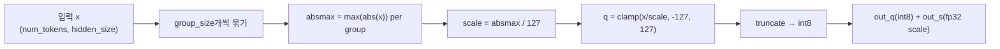
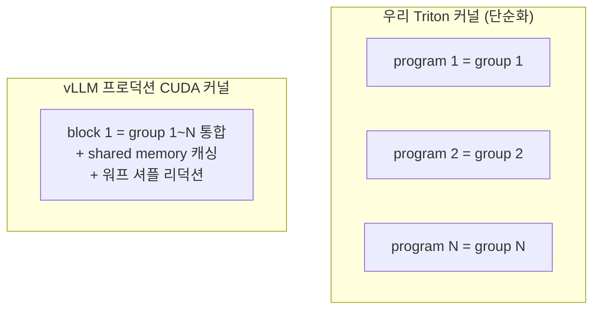
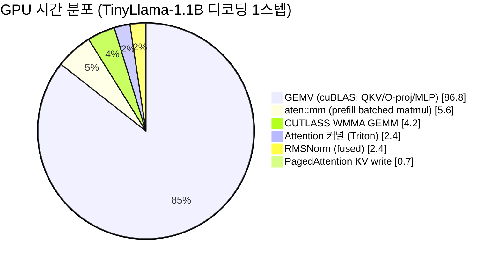

# vLLM 커널 실습 — group quantization

vLLM의 `csrc/libtorch_stable/quantization/w8a8/fp8/per_token_group_quant.cu`
(`per_token_group_quant_8bit_kernel`)을 단순화해서 Triton으로 다시 구현하고,
`torch.ops.*`로 등록해본 연습 프로젝트입니다.

## 커널이 하는 일



## 파일
- `group_quant_triton.py` — 실제 Triton 커널 (`@triton.jit`)
- `group_quant_triton_multi.py` — 프로그램 하나가 그룹 여러 개를 처리하는 버전 (원본의 `groups_per_block`)
- `bench_local.py` — PyTorch 순정 / 우리 Triton / vLLM CUDA 커널 속도·정확도 비교와 `group_size` 스윕
- `group_quant_op.py` — 위 커널을 `torch.ops.practice.group_quant_int8`로 등록
  (vLLM의 `STABLE_TORCH_LIBRARY` + `STABLE_TORCH_LIBRARY_IMPL` 패턴의 Python판)
- `test_group_quant.py` — PyTorch 순정 구현과 정확도 비교 + 벤치마크
- `verify_rtx.py`, `mismatch_breakdown.py` — `verify_claims_colab.ipynb` 2절을 로컬 GPU에서 재실행, PTX 덤프, 불일치 원소 전수 분류
- `ncu_target.py` + `ncu_run.sh`, `sass_target.py` + `sass_run.sh` — Nsight Compute 지표 / SASS 덤프 (리포트 파일은 저장소 밖에 둠)

## Colab에서 돌리기
1. 새 노트북 만들고 이 폴더의 3개 `.py` 파일을 업로드 (또는 같은 내용을 셀에 붙여넣기)
2. **런타임 > 런타임 유형 변경 > GPU** 선택
3. 셀에서:
   ```python
   !python test_group_quant.py
   ```
4. `group_quant_op.py`를 직접 실행해서 등록된 op 확인:
   ```python
   !python group_quant_op.py
   ```

## 원본 CUDA 커널과 다른/단순화한 부분
- 원본은 블록 하나가 여러 그룹(`groups_per_block`)을 처리하고 그룹 하나를
  16개 스레드가 나눠 처리하지만, 여기서는 **Triton 프로그램 하나 = 그룹 하나**로
  단순화했습니다 (`grid = num_tokens * num_groups`).
- 원본은 워프 셔플로 리덕션하고 shared memory에 값을 캐싱해 DRAM을 한 번만
  읽지만, 여기서는 `tl.max`로 리덕션을 Triton이 알아서 처리하게 맡겼습니다.
- scale 계산 후 clamp가 `[-127, 127]`인 것까지는 원본과 동일한 알고리즘입니다.
- 원본은 반올림 없이 truncate(`DST_DTYPE(q)` 캐스트)만 하는데, 이 실습에서도
  그대로 truncate로 맞췄습니다. (처음엔 reference를 `round()`로 짰다가, 원본과
  다른 반올림 방식이라 tie 경계에서 결과가 갈리는 걸 직접 겪고 고쳤습니다.)

## 디버깅 중 발견한 것: fp32 나눗셈 명령 차이
Triton 커널과 PyTorch reference를 완전히 같은 수식으로 짜도, 결과 int8 값이
0.2% 정도(9472개 중 20개) 다르게 나온 적이 있습니다. 다른 원소는 모두 그룹 최댓값 원소이고, 차이는 항상 1이었습니다.
원인은 아래 "RTX 3060 Ti 교차 검증"에서 확인했습니다.

- Triton은 `x / scale`을 PTX `div.full.f32`로 컴파일합니다. PTX 문서는 이 명령을 "not fully IEEE 754 compliant", 최대 오차 2ulp로 설명합니다
  ([PTX ISA: div](https://docs.nvidia.com/cuda/parallel-thread-execution/index.html#floating-point-instructions-div)).
  SASS에서는 역수(`MUFU.RCP`) 뒤 곱(`FMUL`)이었습니다.
- PyTorch의 나눗셈 커널은 SASS에 보정 단계(`FFMA` 연속, `FCHK`)가 있는 다른 명령열이었습니다.
- Triton 나눗셈만 `tl.math.div_rn`(IEEE 반올림 나눗셈)으로 바꾸면 1,677만 개 전부의 `x/scale`이 PyTorch와 비트 단위로 같아졌습니다.
- 그룹 최댓값 원소는 `x/scale`이 127 근처라, 최하위 비트 차이가 truncate 뒤 126과 127로 갈립니다. 방향은 두 가지 모두 나왔습니다
  (3060 Ti에서 21,654개 중 PyTorch 127/Triton 126이 18,039개, PyTorch 126/Triton 127이 3,615개).

로직 버그가 아니므로 `test_group_quant.py`는 "완전 일치"가 아니라 "차이는 최대 1, 1% 미만"까지 허용합니다.

## 실제 vLLM 프로덕션 커널과 비교 (`group_quant_walkthrough.ipynb`)

우리 Triton 커널(program 1개 = group 1개, 단순화)과 vLLM 프로덕션 CUDA 커널
(`per_token_group_quant_int8` — block 1개가 여러 group을 shared memory 캐싱 +
워프 셔플 리덕션으로 처리)을 `torch.ops.*`로 직접 호출해 3-way 벤치마크했습니다.



`group_size`를 32~4096까지 스윕해서 속도·양자화 오차·scale 메모리 오버헤드를
같이 재봤습니다 — 그룹이 작을수록 오차는 줄지만 scale 저장 비용이 늘어나는
전형적인 edge-device 트레이드오프입니다.

## 로컬 GPU 실측 — RTX 3060 Ti (`bench_local.py`)

노트북에는 실행 결과가 남아 있지 않아서, 로컬 GPU에서 같은 비교를 다시 재고 숫자를 남겼습니다.
torch, Triton, vLLM `_C` 확장이 모두 들어 있는 `vllm/vllm-openai:v0.11.2` 이미지 안에서 `python bench_local.py`로 실행했고,
원본은 [`results/bench_rtx_3060_ti.json`](results/bench_rtx_3060_ti.json)입니다.

- 입력: fp16 `[tokens, 4096]`, `group_size=128`. 시간은 `triton.testing.do_bench` 중앙값을 5번 재서 그 중앙값입니다.
- 실효 대역폭: 연산이 최소한 옮겨야 하는 바이트(fp16 읽기 + int8 쓰기 + fp32 scale 쓰기) ÷ 시간. 사양 대역폭은 448GB/s입니다.
- `triton_Ngroups`: README 아래 "다음 실습 아이디어"에 적어 뒀던 것을 구현한 버전입니다.
  원본 CUDA 커널의 `groups_per_block`처럼 프로그램 하나가 그룹 N개를 처리합니다([`group_quant_triton_multi.py`](group_quant_triton_multi.py)).

| 구현 | 16토큰 | 256토큰 | 4096토큰 | 4096토큰 실효 대역폭 |
|---|---|---|---|---|
| PyTorch 순정 (커널 8개) | 44.5µs | 156.0µs | 1,914.2µs | 26.6GB/s (6%) |
| 우리 Triton, 그룹 1개/프로그램 | 5.2µs | 29.0µs | 319.5µs | 159.2GB/s (36%) |
| 우리 Triton, 그룹 2개 | 4.6µs | 14.1µs | 177.1µs | 287.2GB/s (64%) |
| 우리 Triton, 그룹 4개 | 5.5µs | 13.4µs | 148.7µs | 341.9GB/s (76%) |
| **우리 Triton, 그룹 8개** | 9.4µs | 15.9µs | **140.7µs** | **361.4GB/s (81%)** |
| 우리 Triton, 그룹 16개 | 7.0µs | 12.9µs | 146.5µs | 347.0GB/s (77%) |
| **vLLM CUDA** (`per_token_group_quant_int8`) | 8.9µs | **11.9µs** | 155.7µs | 326.6GB/s (73%) |

**핵심 발견**
1. **프로그램당 그룹 수가 성능 차이의 대부분이었습니다.** 그룹 1개짜리 원래 커널은 4096토큰에서 사양 대역폭의 36%만 썼고,
   그룹 8개로 바꾸자 2.27배 빨라져 81%가 됐습니다. 프로그램 수를 그대로 두고 warp 수만 4 → 1로 줄여도 빨라졌으므로(아래 "Colab T4 검증", "RTX 3060 Ti 교차 검증"),
   프로그램 수만으로는 설명되지 않습니다. Nsight Compute로는 4 → 1 warp에서 DRAM 바이트는 거의 같고 실행 명령 수가 3.35배 줄어든 것까지 확인했고,
   그것이 시간 차이의 원인인지는 확인하지 못했습니다. 같은 GPU를 2026-11-02에 venv(cu128)로 다시 쟀을 때는 271.4 → 127.2µs, 2.13배, 89%였습니다(아래 교차 검증 절).
2. **이 크기에서는 vLLM CUDA 커널보다 1.11배 빨랐습니다(140.7 vs 155.7µs).** 다만 공정한 비교는 아닙니다.
   vLLM 커널은 eps 처리, `[-128, 127]` 클램프, column-major scale 같은 기능을 더 갖고 있고, 우리 커널은 이걸 뺐습니다.
   256토큰에서는 vLLM이 가장 빨랐습니다(11.9µs, 우리 최선은 12.9µs).
3. **16토큰처럼 작은 입력에서는 모두 5~9µs라 순위에 의미가 없습니다.** 이 크기에서는 커널 실행 자체의 고정 비용이 지배하고,
   그룹 8개 버전이 오히려 느린 것(9.4µs)도 이 수준의 편차로 봅니다. 디코드처럼 토큰이 적을 때는 커널 하나를 빠르게 하는 것보다
   커널 수를 줄이는 것(PyTorch 8개 → 1개, 44.5 → 5.2µs)이 효과가 컸습니다.
4. **최적값은 크기마다 다릅니다.** 4096토큰은 그룹 8개, 256토큰은 16개, 16토큰은 2개가 가장 빨랐습니다.
   반면 vLLM의 `GetGroupsPerBlock`은 성능을 보고 고르지 않고, 전체 그룹 수가 16·8·4·2로 나누어떨어지는지만 봅니다
   ([per_token_group_quant.cu#L166-L180](https://github.com/vllm-project/vllm/blob/811622c410c2f1baf2fa7056ca19753264b95815/csrc/libtorch_stable/quantization/w8a8/fp8/per_token_group_quant.cu#L166-L180)).
   그래서 이 크기들에서는 항상 16을 씁니다. 크기마다 최적값이 다른 건 우리 Triton 커널에서 잰 결과이고,
   스레드 구성이 다른 vLLM CUDA 커널에서도 그런지는 재지 않았습니다.

참고로 같은 GPU에서 1GiB 복사로 잰 대역폭은 349GB/s였는데, 그룹 8개 버전은 361GB/s가 나왔습니다.
복사는 읽기와 쓰기가 1:1이지만 이 연산은 약 2:1이라, 복사 측정치가 이 연산의 상한은 아닙니다.

**정확도** (4096×4096, PyTorch 순정 대비)
- 우리 Triton 커널(그룹 수와 무관하게 동일): 1,677만 개 중 21,690개(0.13%)가 1 차이, scale은 완전히 같음. 위 "fp32 나눗셈 정밀도 차이"와 같은 현상입니다.
- 그룹 N개 버전은 그룹 1개 버전과 **비트 단위로 같습니다**. 마지막 프로그램이 덜 차는 경우까지 `test_group_quant.py`에 테스트를 추가했습니다.
- vLLM CUDA 커널: 5,950개(0.035%)가 1 차이.

## Colab T4 검증 ([`verify_claims_colab.ipynb`](verify_claims_colab.ipynb), [`results/bench_t4_colab.json`](results/bench_t4_colab.json))

Tesla T4, torch 2.11.0+cu130, Triton 3.6.0. fp16 `[4096, 4096]`, `group_size=128`. 512MiB 복사 대역폭 231GB/s(사양 320GB/s).

| 구현 (4096토큰) | 시간 | 실효 대역폭 |
|---|---|---|
| PyTorch 순정 | 2,811.9µs | 18.1GB/s |
| 그룹 1개/프로그램, 4 warp (기본값) | 485.0µs | 104.8GB/s |
| 그룹 1개/프로그램, 2 warp | 254.0µs | 200.3GB/s |
| 그룹 1개/프로그램, 1 warp | 229.2µs | 221.8GB/s |
| 그룹 8개/프로그램, 4 warp | 202.8µs | 250.8GB/s |

- 프로그램 수가 같은 커널에서 warp 수만 4 → 1로 줄여 2.1배 빨라졌습니다. 그래서 그룹 1개 버전이 느린 것은 프로그램 수만으로는 설명되지 않습니다. 그룹당 스레드 수를 줄였을 때 왜 빨라지는지는 아래 "원인 확인 B"에서 지표로 확인한 만큼만 적었습니다.
- `torch.profiler`로 센 커널 수: PyTorch 순정 8개, Triton 1개.
- PyTorch 참조 구현과의 차이: 1,677만 개 중 21,743개, 모두 1 차이, scale은 동일. 차이가 난 원소는 모두 그룹 최댓값 원소였습니다. 노트북은 앞의 5개만 출력했고, 그 5개는 PyTorch `x/scale`이 ±127.000000, Triton이 ±126인 경우였습니다. 전체를 분류하면 반대 방향도 있습니다(아래 "RTX 3060 Ti 교차 검증").
- 그룹 8개 버전은 그룹 1개 버전과 비트 단위로 같습니다.

**`group_size` 스윕** (4096×4096, 입력 표준편차 5)

| group_size | 평균 상대 오차 | scale 메모리 | int8 대비 scale 오버헤드 |
|---|---|---|---|
| 32 | 4.30% | 2,048KB | 12.5% |
| 64 | 4.70% | 1,024KB | 6.25% |
| 128 | 5.05% | 512KB | 3.13% |
| 256 | 5.36% | 256KB | 1.56% |
| 1024 | 5.93% | 64KB | 0.39% |
| 4096 | 6.43% | 16KB | 0.10% |

그룹을 32에서 4096으로 128배 키우면 scale 오버헤드는 12.5%에서 0.1%로 줄지만, 오차는 4.30%에서 6.43%로 1.5배가 됩니다.
정규분포 입력이라 outlier가 거의 없는 경우의 숫자입니다. 실제 활성값처럼 outlier가 있으면 큰 그룹의 오차는 더 커집니다.

## RTX 3060 Ti 교차 검증 ([`verify_rtx.py`](verify_rtx.py), [`results/verify_rtx_3060_ti.json`](results/verify_rtx_3060_ti.json))

위 Colab T4 검증과 같은 코드(`verify_claims_colab.ipynb` 2절, 셀 9·10)를 로컬 GPU에서 다시 돌렸습니다.

- 환경: RTX 3060 Ti 8GB, 드라이버 581.80(nvidia-smi 표시 CUDA 13.0), WSL2 Ubuntu 22.04.
  torch 2.9.0+cu128, Triton 3.5.0, vLLM 0.11.2를 **pip venv**에 설치해 실행했습니다.
  이전 측정에 쓴 `vllm/vllm-openai:v0.11.2` 이미지(torch 2.9.0+cu129)는 디스크 용량 문제로 이번에는 쓰지 못했습니다.
- 시간: `triton.testing.do_bench(return_mode='median')` 5회, 표는 그 중앙값입니다. 5회 값은 JSON에 모두 있습니다.
  do_bench 결과가 5회 모두 같은 값으로 나온 칸이 있습니다(예: 266.24µs ×5).

**(a) 4096토큰, fp16 `[4096, 4096]`, `group_size=128`**

| 구현 | T4 | RTX 3060 Ti (중앙값) | RTX 3060 Ti 5회 | 3060 Ti 실효 대역폭 |
|---|---|---|---|---|
| PyTorch 순정 | 2,811.9µs | 1,632.3µs | 1635.3, 1634.8, 1632.3, 1632.3, 1632.3 | 31.2GB/s |
| 그룹 1개/프로그램, 4 warp (기본값) | 485.0µs | 266.2µs | 266.2 ×5 | 191.0GB/s |
| 그룹 1개/프로그램, 2 warp | 254.0µs | 187.4µs | 187.4 ×5 | 271.4GB/s |
| 그룹 1개/프로그램, 1 warp | 229.2µs | 170.8µs | 170.7, 170.8, 170.8, 171.0, 170.8 | 297.8GB/s |
| 그룹 8개/프로그램, 4 warp | 202.8µs | 126.0µs | 126.0 ×5 | 403.8GB/s |

- 순서(4 warp > 2 warp > 1 warp > 그룹 8개)는 T4와 같았습니다. 4 → 1 warp 배율은 T4 2.12배, 3060 Ti 1.56배입니다.
- 512MiB 복사 대역폭: 414.3GB/s(5회 413.8~414.5). 측정 방법은 노트북과 같습니다(fp16 512MiB, do_bench 중앙값).
- 16·256토큰(중앙값, µs): PyTorch 31.7 / 128.7, 1 warp 4.2 / 14.3, 2 warp 4.3 / 15.4, 4 warp 5.1 / 20.5, 그룹 8개 4.1 / 11.9.

**기존 `results/bench_rtx_3060_ti.json`과 비교 (같은 GPU, `bench_local.py`와 같은 측정법 = do_bench 기본값 `mean`, 5회 중앙값)**

| 4096토큰 | 기존 값 (이미지, cu129) | 이번 값 (venv, cu128) | 이번 5회 |
|---|---|---|---|
| PyTorch 순정 | 1,914.2µs | 1,653.4µs | 1653.4, 1677.1, 1635.4, 1635.4, 1672.7 |
| 그룹 1개 (= 4 warp) | 319.5µs | 271.4µs | 271.4, 271.5, 271.2, 273.0, 269.2 |
| 그룹 8개 | 140.7µs | 127.2µs | 127.2, 127.3, 126.7, 126.9, 127.8 |
| 그룹 1개 → 8개 배율 | 2.27배 | 2.13배 | |
| 그룹 8개 실효 대역폭 (사양 448GB/s 대비) | 361.4GB/s (81%) | 399.8GB/s (89%) | |

같은 GPU인데 이번 값이 모두 더 빠릅니다. 이전과 달라진 것은 실행 환경(컨테이너 → venv, torch cu129 → cu128), 드라이버 시점입니다. 어느 것이 차이를 만들었는지는 확인하지 못했습니다.
위 "로컬 GPU 실측" 절의 1GiB 복사 349GB/s와 이번 512MiB 복사 414.3GB/s도 측정법(크기·dtype·반복 방식)이 다르고 차이의 원인은 확인하지 못했습니다.

**(b) PyTorch 참조 구현과의 차이** (seed 0, `randn * 5`)

| 항목 | T4 | RTX 3060 Ti |
|---|---|---|
| 다른 원소 수 (1,677만 개 중) | 21,743 | 21,654 |
| 최대 차이 | 1 | 1 |
| scale 동일 | 예 | 예 |
| 그룹 8개 == 그룹 1개 (비트 단위) | 예 | 예 |

3060 Ti에서 다른 원소 21,654개를 **전부** 분류했습니다([`mismatch_breakdown.py`](mismatch_breakdown.py), [`results/mismatch_breakdown_rtx_3060_ti.json`](results/mismatch_breakdown_rtx_3060_ti.json)).
모두 그룹 최댓값 원소였고, 두 가지 경우뿐이었습니다.

| PyTorch `x/scale` | Triton `x/scale` | PyTorch q | Triton q | 개수 |
|---|---|---|---|---|
| ±127.0 | ±126.99999237 | ±127 | ±126 | 18,039 |
| ±126.99999237 | ±127.0 | ±126 | ±127 | 3,615 |

T4 절의 "PyTorch는 정확히 ±127.000000, Triton은 ±126"은 첫 번째 경우에만 맞습니다. T4 노트북은 앞의 5개만 출력했습니다.
Triton 쪽 `x/scale`은 같은 식을 fp32로 저장하는 커널로 따로 계산했고, 이를 `trunc(clamp(...))`한 값이 실제 커널의 q와 전부 일치하는 것을 확인했습니다.
전체 1,677만 개 중 두 구현의 `x/scale`이 비트 단위로 다른 원소는 5,296,989개, 최대 차이 1.53e-5였습니다.

**(c) `torch.profiler`로 센 커널 수**: PyTorch 순정 8개, Triton 그룹 1개 1개, 그룹 8개 1개. T4와 같습니다.

### 원인 확인 A — 나눗셈이 어떤 명령으로 컴파일됐나

PTX는 `_group_quant_int8_kernel[grid](...)`가 돌려준 컴파일 결과의 `asm["ptx"]`에서 꺼냈습니다([`results/ptx/`](results/ptx/)).
`num_warps=4` 커널의 실수 나눗셈 줄은 두 개이고, PTX의 `.loc` 주석으로 소스 줄을 확인했습니다(이 밖의 `div.s32`는 `pid // num_groups`).

```
	mov.b32 	%r42, 0f42FE0000;                       // 127.0
	.loc	1 39 21                         // group_quant_triton.py:39:21   scale = absmax / 127.0
	div.full.f32 	%r43, %r41, %r42;
	.loc	1 45 34                         // group_quant_triton.py:45:34   x / scale
	div.full.f32 	%r44, %r23, %r7;
```

1·2 warp 버전과 그룹 8개 버전도 `x / scale`은 모두 `div.full.f32`였습니다(스레드당 원소 수만큼 반복).
Nsight Compute로 뽑은 SASS([`results/sass_div.txt`](results/sass_div.txt), [`sass_run.sh`](sass_run.sh))에서는 이 부분이 아래처럼 나왔습니다.

```
Triton _group_quant_int8_kernel (num_warps=4)
  72  FMUL R10, R10, 0.0078740157186985015869      # 상수 = 1/127
  81  MUFU.RCP R4, R4
  88  FMUL R5, R4, R5
  89  FMNMX R5, R5, -127, !PT
  90  FMNMX R5, R5, 127, PT
  91  F2I.S16.TRUNC.NTZ R5, R5
PyTorch at::native::elementwise_kernel<..., DivFunctor<float>>
 269  MUFU.RCP R3, R9
 270  FCHK P0, R0, R9
 271  FFMA R4, -R9, R3, 1
 272  FFMA R3, R3, R4, R3
 273  FFMA R4, R0, R3, RZ
 274  FFMA R2, -R9, R4, R0
 275  FFMA R3, R3, R2, R4
 276  @!P0  BRA 0x500e9af90
      ... (FCHK가 걸리면 CALL.REL.NOINC 로 별도 경로)
```

Triton 커널 SASS에는 `FCHK`와 `CALL`이 없었고(전체 112줄), PyTorch 나눗셈 커널에는 각각 2개가 있었습니다.
같은 입력에서 Triton 나눗셈만 `tl.math.div_rn`(PTX `div.rn.ftz.f32`)으로 바꾸면, 1,677만 개 전부의 `x/scale`이 PyTorch와 비트 단위로 같아졌습니다.
scale 계산(`absmax / 127.0`)은 Triton SASS에서 상수 곱(`FMUL … 0.00787…`)이었고, PyTorch 쪽도 커널 목록에 나눗셈이 아니라 `MulFunctor`가 있습니다. scale은 두 구현이 같았습니다.

### 원인 확인 B — Nsight Compute ([`ncu_run.sh`](ncu_run.sh), [`ncu_target.py`](ncu_target.py), [`results/ncu_metrics.csv`](results/ncu_metrics.csv))

Nsight Compute 2026.3.1. 2023.2.2는 `Profiling is not supported on device 0 as it uses the Windows Subsystem for Linux (WSL)`로 실행되지 않았습니다.
2026.3.1도 처음엔 `ERR_NVGPUCTRPERM`이 났고, NVIDIA 제어판에서 "모든 사용자에게 GPU 성능 카운터 액세스 허용"을 켜고 WSL을 재시작한 뒤 동작했습니다.
입력은 4096토큰, 각 커널은 한 번 워밍업 후 두 번째 실행을 쟀습니다. ncu 시간은 프로파일러 아래에서 잰 값이라 대표 수치로 쓰지 않습니다.

| 지표 | 그룹 1개, 4 warp | 그룹 1개, 1 warp | 그룹 8개, 4 warp |
|---|---|---|---|
| grid × block | 131,072 × 128 | 131,072 × 32 | 16,384 × 128 |
| 스레드당 원소 수 (코드에서 계산) | 128/128 = 1 | 128/32 = 4 | 1024/128 = 8 |
| 시간 (ncu `gpu__time_duration`) | 304.4µs | 190.8µs | 123.6µs |
| DRAM 처리량 (peak 대비) | 39.0% | 61.6% | 94.8% |
| DRAM 처리량 | 169.5GB/s | 267.9GB/s | 411.9GB/s |
| DRAM 읽기 / 쓰기 | 34.0MB / 17.6MB | 33.6MB / 17.5MB | 33.6MB / 17.3MB |
| achieved occupancy | 88.0% | 28.0% | 94.5% |
| theoretical occupancy (제한 요인) | 100% | 33.3% (SM당 블록 16개 한도) | 100% |
| 실행 명령 수 (warp 단위) | 49,545,216 | 14,811,136 | 8,093,696 |
| 실행 명령 수 (thread 단위) | 1,577,320,448 | 465,829,888 | 256,638,976 |
| global load / store 명령 (warp 단위) | 524,288 / 655,360 | 131,072 / 262,144 | 65,536 / 81,920 |
| SM throughput (peak 대비) | 77.7% | 30.2% | 26.9% |

**4 → 1 warp에서 지표로 설명되는 것**
- DRAM에서 읽고 쓴 바이트는 거의 같습니다(읽기 34.0 → 33.6MB). 옮긴 데이터 양이 줄어서 빨라진 것은 아닙니다.
- 실행된 명령 수가 3.35배 줄었습니다(warp 단위 49.5M → 14.8M). global load 명령은 4배, store 명령은 2.5배 줄었습니다.
- SM throughput은 77.7% → 30.2%로 내려가고, DRAM 처리량은 39.0% → 61.6%로 올라갔습니다.
- achieved occupancy는 88.0% → 28.0%로 떨어졌는데도 빨라졌습니다. occupancy로는 속도 향상을 설명할 수 없습니다.

**지표로 설명되지 않는 것**
- 4 warp 커널에서 SM throughput 77.7%를 차지한 것이 SM 안의 어느 유닛인지는 재지 않았습니다. 그래서 명령 수 감소가 시간 감소의 직접 원인인지는 이 표만으로 단정할 수 없습니다.
- 명령 수는 3.35배 줄었는데 시간은 1.6배(ncu) 줄었습니다. 이 차이는 설명하지 못했습니다.
- 1 warp → 그룹 8개에서는 명령 수(14.8M → 8.1M), occupancy(28.0 → 94.5%), DRAM 처리량(61.6 → 94.8%)이 함께 바뀌어, 어느 쪽이 시간 차이를 만들었는지 나눌 수 없습니다.

## `run_vllm_on_colab.ipynb` — vLLM을 실제로 돌려서 병목 확인

커널 하나만 보는 대신, vLLM 자체를 Colab GPU에서 띄워 TinyLlama-1.1B로 실제
추론을 돌리고 `torch.profiler`로 GPU 시간을 프로파일링했습니다.



**핵심 발견**: attention 커널은 GPU 시간의 2.4%뿐이고, 압도적 1위는 GEMV(86.8%)
입니다. 디코딩은 배치=1이라 가중치 원소 하나당 곱셈을 한 번만 해서
memory-bandwidth-bound가 되기 때문입니다. 이 경우 직접 듣는 해법은 가중치를
양자화해 HBM에서 읽는 바이트 수를 줄이는 것(weight-only int8/int4)입니다.
참고로 이 저장소의 group quantization 커널은 가중치가 아니라 **활성값**을 실행 중에
토큰별 그룹으로 양자화하는 커널입니다(vLLM에서는 W8A8 블록 양자화 GEMM 직전에
입력 `A`에 적용, 예: [fused_moe/utils.py#L192](https://github.com/vllm-project/vllm/blob/811622c410c2f1baf2fa7056ca19753264b95815/vllm/model_executor/layers/fused_moe/utils.py#L192)).
그래서 가중치 읽기를 줄이지는 않고, 이 커널 자체의 성능도 같은 이유로 메모리 대역폭이 정합니다. Colab/Jupyter 환경에서 vLLM을 직접 띄우며
겪은 `libcudart.so` 경로, fork+CUDA 크래시, `pynvml` 초기화 실패 같은 실전
이슈들도 커밋 로그에 그대로 남아있습니다.

## 다음 실습 아이디어 (edge 제약 관점)
- `group_size`를 32/64/128/256으로 바꿔가며 벤치마크 → 그룹이 작을수록
  스케일 정밀도는 좋아지지만 오버헤드(스케일 개수)가 늘어나는 트레이드오프를
  직접 수치로 확인
- ~~`_group_quant_int8_kernel`을 원본처럼 "프로그램 하나가 여러 그룹을 처리"하도록
  바꿔보고 성능이 어떻게 달라지는지 비교~~ → 했습니다. 위 "로컬 GPU 실측" 참고 (4096토큰에서 2.27배)
- 그룹 수를 shape에 따라 자동으로 고르기 (`triton.autotune`) — 위 실측에서 크기마다 최적값이 달랐음
- INT8 대신 INT4로 바꿔서 압축률/정확도 트레이드오프 실험 (edge 메모리 제약
  시나리오에 더 가까움)
