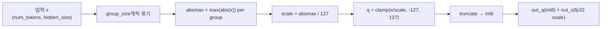
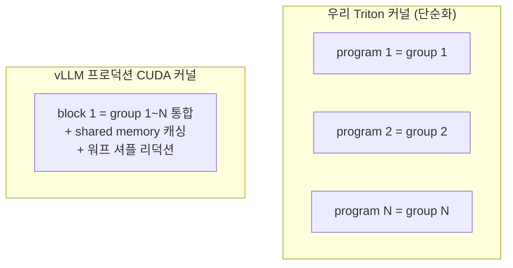
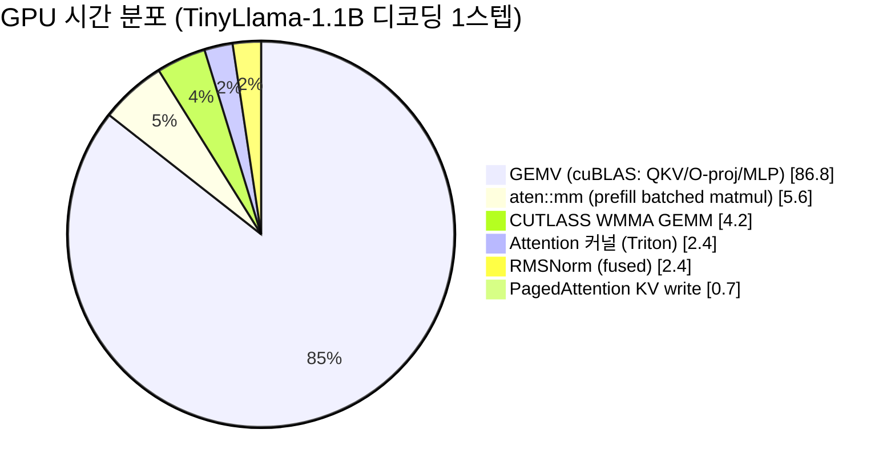

# vLLM 커널 실습 — group quantization

vLLM의 `csrc/libtorch_stable/quantization/w8a8/fp8/per_token_group_quant.cu`
(`per_token_group_quant_8bit_kernel`)을 단순화해서 Triton으로 다시 구현하고,
`torch.ops.*`로 등록해본 연습 프로젝트입니다.

## 커널이 하는 일



## 파일
- `group_quant_triton.py` — 실제 Triton 커널 (`@triton.jit`)
- `group_quant_triton_multi.py` — 프로그램 하나가 그룹 여러 개를 처리하는 버전 (원본의 `groups_per_block`)
- `bench_local.py` — PyTorch 순정 / 우리 Triton / vLLM CUDA 커널 속도·정확도 비교와 `group_size` 스윕
- `group_quant_op.py` — 위 커널을 `torch.ops.practice.group_quant_int8`로 등록
  (vLLM의 `STABLE_TORCH_LIBRARY` + `STABLE_TORCH_LIBRARY_IMPL` 패턴의 Python판)
- `test_group_quant.py` — PyTorch 순정 구현과 정확도 비교 + 벤치마크

## Colab에서 돌리기
1. 새 노트북 만들고 이 폴더의 3개 `.py` 파일을 업로드 (또는 같은 내용을 셀에 붙여넣기)
2. **런타임 > 런타임 유형 변경 > GPU** 선택
3. 셀에서:
   ```python
   !python test_group_quant.py
   ```
4. `group_quant_op.py`를 직접 실행해서 등록된 op 확인:
   ```python
   !python group_quant_op.py
   ```

## 원본 CUDA 커널과 다른/단순화한 부분
- 원본은 블록 하나가 여러 그룹(`groups_per_block`)을 처리하고 그룹 하나를
  16개 스레드가 나눠 처리하지만, 여기서는 **Triton 프로그램 하나 = 그룹 하나**로
  단순화했습니다 (`grid = num_tokens * num_groups`).
- 원본은 워프 셔플로 리덕션하고 shared memory에 값을 캐싱해 DRAM을 한 번만
  읽지만, 여기서는 `tl.max`로 리덕션을 Triton이 알아서 처리하게 맡겼습니다.
- scale 계산 후 clamp가 `[-127, 127]`인 것까지는 원본과 동일한 알고리즘입니다.
- 원본은 반올림 없이 truncate(`DST_DTYPE(q)` 캐스트)만 하는데, 이 실습에서도
  그대로 truncate로 맞췄습니다. (처음엔 reference를 `round()`로 짰다가, 원본과
  다른 반올림 방식이라 tie 경계에서 결과가 갈리는 걸 직접 겪고 고쳤습니다.)

## 디버깅 중 발견한 것: fp32 나눗셈 정밀도 차이
Triton 커널과 PyTorch reference를 완전히 같은 수식으로 짜도, 결과 int8 값이
0.2% 정도(9472개 중 20개) 다르게 나온 적이 있습니다. 원인은 `x / scale` 나눗셈
자체가 Triton과 PyTorch에서 **bit-identical하지 않다는 것** — GPU는 성능을 위해
나눗셈을 근사 역수(fast reciprocal approximation)로 계산하는 경우가 많아서, 참값이
`127.0`처럼 정수 경계에 아주 가까우면(`126.999996` vs `127.000001`) truncate 결과가
이웃한 정수로 갈릴 수 있습니다. 로직 버그가 아니라 fast-math 트레이드오프의 흔적이라,
`test_group_quant.py`는 "완전 일치"가 아니라 "경계 근처에서만, 드물게, 최대 1 차이까지"
허용하도록 짜여 있습니다. Edge 디바이스에서 정밀도-속도 트레이드오프를 다룰 때 실제로
부딪히는 종류의 문제라 그대로 남겨뒀습니다.

## 실제 vLLM 프로덕션 커널과 비교 (`group_quant_walkthrough.ipynb`)

우리 Triton 커널(program 1개 = group 1개, 단순화)과 vLLM 프로덕션 CUDA 커널
(`per_token_group_quant_int8` — block 1개가 여러 group을 shared memory 캐싱 +
워프 셔플 리덕션으로 처리)을 `torch.ops.*`로 직접 호출해 3-way 벤치마크했습니다.



`group_size`를 32~4096까지 스윕해서 속도·양자화 오차·scale 메모리 오버헤드를
같이 재봤습니다 — 그룹이 작을수록 오차는 줄지만 scale 저장 비용이 늘어나는
전형적인 edge-device 트레이드오프입니다.

## 로컬 GPU 실측 — RTX 3060 Ti (`bench_local.py`)

노트북에는 실행 결과가 남아 있지 않아서, 로컬 GPU에서 같은 비교를 다시 재고 숫자를 남겼습니다.
torch, Triton, vLLM `_C` 확장이 모두 들어 있는 `vllm/vllm-openai:v0.11.2` 이미지 안에서 `python bench_local.py`로 실행했고,
원본은 [`results/bench_rtx_3060_ti.json`](results/bench_rtx_3060_ti.json)입니다.

- 입력: fp16 `[tokens, 4096]`, `group_size=128`. 시간은 `triton.testing.do_bench` 중앙값을 5번 재서 그 중앙값입니다.
- 실효 대역폭: 연산이 최소한 옮겨야 하는 바이트(fp16 읽기 + int8 쓰기 + fp32 scale 쓰기) ÷ 시간. 사양 대역폭은 448GB/s입니다.
- `triton_Ngroups`: README 아래 "다음 실습 아이디어"에 적어 뒀던 것을 구현한 버전입니다.
  원본 CUDA 커널의 `groups_per_block`처럼 프로그램 하나가 그룹 N개를 처리합니다([`group_quant_triton_multi.py`](group_quant_triton_multi.py)).

| 구현 | 16토큰 | 256토큰 | 4096토큰 | 4096토큰 실효 대역폭 |
|---|---|---|---|---|
| PyTorch 순정 (커널 8개) | 44.5µs | 156.0µs | 1,914.2µs | 26.6GB/s (6%) |
| 우리 Triton, 그룹 1개/프로그램 | 5.2µs | 29.0µs | 319.5µs | 159.2GB/s (36%) |
| 우리 Triton, 그룹 2개 | 4.6µs | 14.1µs | 177.1µs | 287.2GB/s (64%) |
| 우리 Triton, 그룹 4개 | 5.5µs | 13.4µs | 148.7µs | 341.9GB/s (76%) |
| **우리 Triton, 그룹 8개** | 9.4µs | 15.9µs | **140.7µs** | **361.4GB/s (81%)** |
| 우리 Triton, 그룹 16개 | 7.0µs | 12.9µs | 146.5µs | 347.0GB/s (77%) |
| **vLLM CUDA** (`per_token_group_quant_int8`) | 8.9µs | **11.9µs** | 155.7µs | 326.6GB/s (73%) |

**핵심 발견**
1. **프로그램당 그룹 수가 성능 차이의 대부분이었습니다.** 그룹 1개짜리 원래 커널은 4096토큰에서 사양 대역폭의 36%만 썼고,
   그룹 8개로 바꾸자 2.27배 빨라져 81%가 됐습니다. 그룹 하나는 128원소(fp16 256바이트)뿐이라, 프로그램 하나가 하는 일이 너무 작았던 것으로 보입니다.
2. **이 크기에서는 vLLM CUDA 커널보다 1.11배 빨랐습니다(140.7 vs 155.7µs).** 다만 공정한 비교는 아닙니다.
   vLLM 커널은 eps 처리, `[-128, 127]` 클램프, column-major scale 같은 기능을 더 갖고 있고, 우리 커널은 이걸 뺐습니다.
   256토큰에서는 vLLM이 가장 빨랐습니다(11.9µs, 우리 최선은 12.9µs).
3. **16토큰처럼 작은 입력에서는 모두 5~9µs라 순위에 의미가 없습니다.** 이 크기에서는 커널 실행 자체의 고정 비용이 지배하고,
   그룹 8개 버전이 오히려 느린 것(9.4µs)도 이 수준의 편차로 봅니다. 디코드처럼 토큰이 적을 때는 커널 하나를 빠르게 하는 것보다
   커널 수를 줄이는 것(PyTorch 8개 → 1개, 44.5 → 5.2µs)이 효과가 컸습니다.
4. **최적값은 크기마다 다릅니다.** 4096토큰은 그룹 8개, 256토큰은 16개, 16토큰은 2개가 가장 빨랐습니다.
   vLLM이 shape에 따라 `groups_per_block`을 고르는 이유를 직접 확인한 셈입니다.

참고로 같은 GPU에서 1GiB 복사로 잰 대역폭은 349GB/s였는데, 그룹 8개 버전은 361GB/s가 나왔습니다.
복사는 읽기와 쓰기가 1:1이지만 이 연산은 약 2:1이라, 복사 측정치가 이 연산의 상한은 아닙니다.

**정확도** (4096×4096, PyTorch 순정 대비)
- 우리 Triton 커널(그룹 수와 무관하게 동일): 1,677만 개 중 21,690개(0.13%)가 1 차이, scale은 완전히 같음. 위 "fp32 나눗셈 정밀도 차이"와 같은 현상입니다.
- 그룹 N개 버전은 그룹 1개 버전과 **비트 단위로 같습니다**. 마지막 프로그램이 덜 차는 경우까지 `test_group_quant.py`에 테스트를 추가했습니다.
- vLLM CUDA 커널: 5,950개(0.035%)가 1 차이.

**`group_size` 스윕** (4096×4096, 입력 표준편차 5)

| group_size | 평균 상대 오차 | scale 메모리 | int8 대비 scale 오버헤드 |
|---|---|---|---|
| 32 | 4.30% | 2,048KB | 12.5% |
| 64 | 4.70% | 1,024KB | 6.25% |
| 128 | 5.05% | 512KB | 3.13% |
| 256 | 5.36% | 256KB | 1.56% |
| 1024 | 5.93% | 64KB | 0.39% |
| 4096 | 6.43% | 16KB | 0.10% |

그룹을 32에서 4096으로 128배 키우면 scale 오버헤드는 12.5%에서 0.1%로 줄지만, 오차는 4.30%에서 6.43%로 1.5배가 됩니다.
정규분포 입력이라 outlier가 거의 없는 경우의 숫자입니다. 실제 활성값처럼 outlier가 있으면 큰 그룹의 오차는 더 커집니다.

## `run_vllm_on_colab.ipynb` — vLLM을 실제로 돌려서 병목 확인

커널 하나만 보는 대신, vLLM 자체를 Colab GPU에서 띄워 TinyLlama-1.1B로 실제
추론을 돌리고 `torch.profiler`로 GPU 시간을 프로파일링했습니다.



**핵심 발견**: attention 커널은 GPU 시간의 2.4%뿐이고, 압도적 1위는 GEMV(86.8%)
입니다. 디코딩은 배치=1이라 가중치 원소 하나당 곱셈을 한 번만 해서
memory-bandwidth-bound가 되기 때문입니다 — 이게 바로 이 저장소의 group
quantization 커널이 실제로 푸는 문제입니다 (가중치를 int8로 줄여 HBM에서
읽어야 할 바이트 수 자체를 줄임). Colab/Jupyter 환경에서 vLLM을 직접 띄우며
겪은 `libcudart.so` 경로, fork+CUDA 크래시, `pynvml` 초기화 실패 같은 실전
이슈들도 커밋 로그에 그대로 남아있습니다.

## 다음 실습 아이디어 (edge 제약 관점)
- `group_size`를 32/64/128/256으로 바꿔가며 벤치마크 → 그룹이 작을수록
  스케일 정밀도는 좋아지지만 오버헤드(스케일 개수)가 늘어나는 트레이드오프를
  직접 수치로 확인
- ~~`_group_quant_int8_kernel`을 원본처럼 "프로그램 하나가 여러 그룹을 처리"하도록
  바꿔보고 성능이 어떻게 달라지는지 비교~~ → 했습니다. 위 "로컬 GPU 실측" 참고 (4096토큰에서 2.27배)
- 그룹 수를 shape에 따라 자동으로 고르기 (`triton.autotune`) — 위 실측에서 크기마다 최적값이 달랐음
- INT8 대신 INT4로 바꿔서 압축률/정확도 트레이드오프 실험 (edge 메모리 제약
  시나리오에 더 가까움)
